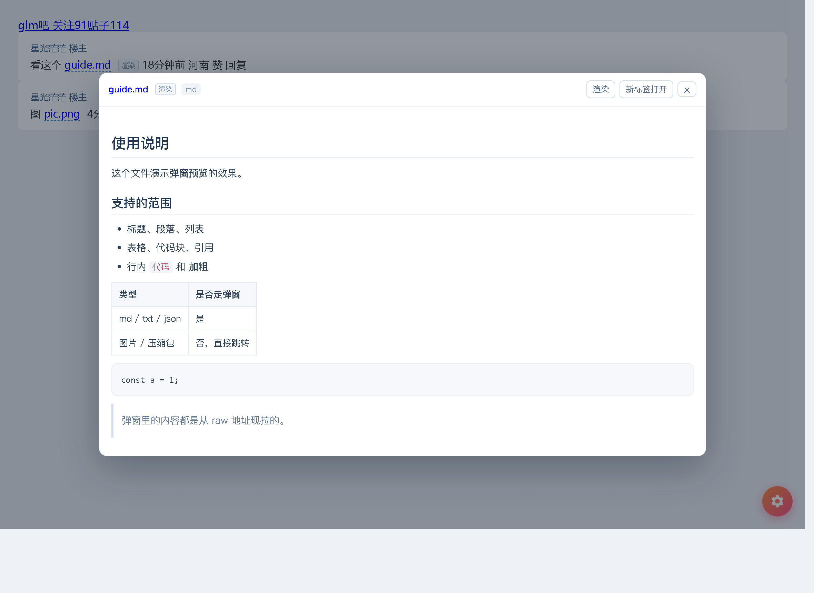

# hubuuid

把贴吧帖子里提到的文件名，自动变成指向你 GitHub 仓库的可点击链接。


帖子里有人发 `1793439932681` 或 `h8876hfrti.md`，装完就能点，点开就是仓库里那个文件。

## 目录

- [一、文件放哪、帖子里怎么写](#一文件放哪帖子里怎么写)　**先看这节，决定能不能用**
- [二、支持哪些文件](#二支持哪些文件)
- [三、安装](#三安装)
- [四、配置](#四配置)
- [五、工作原理](#五工作原理)
- [六、限制](#六限制)
- [七、许可](#七许可)

---

## 一、文件放哪、帖子里怎么写

脚本不是"扫到像文件名的就转"，它先拉你仓库的**文件清单**，再拿清单里的名字去页面上逐字比对。所以下面每一条都是硬规则，不满足就点不了。

### 1.1 必须放在仓库根目录

文字规则，五条：

1. 脚本请求 `api.github.com/repos/<用户名>/<仓库>/contents/?ref=<分支>`，**不带任何路径参数**，只拿根目录这一层，不递归。
2. 返回结果里只保留 `type` 为 `file` 的条目，`type` 为 `dir` 的文件夹直接丢弃。
3. 所以子目录里的文件压根不进清单。帖子里写 `docs/guide.md` 也不行——清单里没有这个字符串，比对不上。
4. 分支名必须真实存在（`main`、`master` 或其他）。写错了接口返回 404，这个仓库一个文件都读不到。
5. 仓库必须是公开的。脚本不带任何令牌，请求私有仓库同样返回 404。

示意图：

```
my-repo/
├── 1793439932681.jpg        ✅ 帖子发 1793439932681 能点
├── h8876hfrti.md            ✅ 帖子发 h8876hfrti 能点
├── 2024-report.pdf          ✅ 帖子发 2024-report 能点
│
├── docs/
│   ├── guide.md             ❌ 帖子发 guide 点不了
│   └── setup.md             ❌ 发 docs/setup.md 也点不了
│
└── images/
    └── 1779779069090.png    ❌ 帖子发 1779779069090 点不了
```

想分类又不想失效，只能用**文件名前缀**代替文件夹：

```
my-repo/
├── img-1793439932681.jpg    帖子发 img-1793439932681 能点
└── doc-h8876hfrti.md        帖子发 doc-h8876hfrti 能点
```

代价是帖子里得把前缀一起打出来。

### 1.2 名字所在的文字片段，要满足这些

下面按判定顺序列。因为整套逻辑都跑在贴吧页面的文字上，所以看的是**帖子里那一段文字长什么样**，不是单纯的 filename 合法性。任何一条不满足就点不了。

1. **那一段文字至少 8 个字符。** 脚本会跳过过短的文本节点。帖子里整行只写 `a.md`（4 个字符）不处理，写成 `看看 a.md 这个`（10 个字符）就处理。注意这是按整段算的，不是按名字长度算。

2. **名字两边不能被字母、数字、下划线包住。** 匹配用的是词边界，两侧要有断开的位置。`id1793439932681` 不行，前面紧贴字母；`1793439932681abc` 也不行，后面紧贴字母。

3. **空格、中文、标点隔开都可以。** `图在 1793439932681`、`图在1793439932681这`、`图在:1793439932681,` 三种写法都能识别。

4. **大小写无所谓。** 写 `H8876HFRTI.MD` 也能认出来，链接仍然指向仓库里那个真实文件名。

5. **名字第一个字符必须是 A-Z、a-z、0-9、_ 之一。** 以连字符开头（`-abc123.md`）、以点开头（`.abc123.md`）、以中文开头（`报告.md`、`中文abc123.md`），全都识别不了。

6. **最后一个字符同样是这四类。** 扩展名一般以字母结尾，所以这条基本自动满足。

7. **中间放什么都行。** 实测空格、`+`、`#`、`&`、`%`、`@`、`~`、`!`、`-`、`_`、`.` 全部可用，混着用也行（`a_b-c.d123.md`）。这些符号只在 URL 里被编码，空格变 `%20`、`#` 变 `%23`、`%` 变 `%25`，不影响点开。

8. **能写多长：实测 121 个字符仍可识别。** 没做上限测试，实际瓶颈是贴吧那行的显示宽度，太长了会被折行。

9. **可以只写不带扩展名的简写，但要过三关。** 简写必须同时满足：长度 ≥ 8、至少含 1 个数字、没有同名文件。`h8876hfrti`（10 位含数字）可以，`notes`（5 位）不行。

10. **数字至少 1 个，位置不限。** `123abc`、`abc123`、`a1b2c3` 都一样能用。纯字母的简写不成立。

11. **纯字母的文件名可以用，前提是它本来就没有扩展名。** 文件叫 `abcdefgh` 时发 `abcdefgh` 能识别；文件叫 `abcdefgh.md` 时发 `abcdefgh` 不行（缺数字），得写全名。

12. **中文名不行。** 首字符是中文时识别率为零。中文出现在中间才行（`a中文b123.md` 通过），但那种名字没实际意义。

13. **重名时只能写全名。** 仓库里同时有 `abc123.md` 和 `abc123.jpg`，发 `abc123` 不识别。

14. **被贴吧拆开时，只有纯 ASCII 的名字能拼回。** 数字被表情切断（`17934399😀32681`）、字母数字被切断（`h8876h😀frti`）、楼中楼被 span 切开（`看 17934` + `39932681`）都能拼回来；中文被切断、被换行切断、名字里带空格被切断，都拼不回。

15. **黑名单里的 6 个名字不处理。** `LICENSE`、`README.md`、`readme`、`.gitignore`、`index.html`、`package.json`。

### 1.3 命名建议

按照上面的规则，文件叫什么最省事：

用时间戳命名最稳，比如 `1793439932681.jpg`，位数够、含数字、纯 ASCII，天然满足全部条件。

字母数字混排也行，比如 `h8876hfrti.md`、`a9b8c7d6e5.png`，同样满足。

别用中文，别在名字里放空格。这两样即使勉强能用，在贴吧里也很容易失效。

名字不到 8 位、或者纯字母的，发帖时一定带上扩展名写成全名。

## 二、支持哪些文件

**脚本不检查扩展名。** 仓库根目录里任何 `type: file` 的条目都会进清单，所以什么格式都能识别。

区别在点开之后分两类。

### 文本类：弹窗预览，不跳走

包括 `md`、`txt`、`json`、`js`、`ts`、`css`、`html`、`xml`、`yml`、`csv`、`log`、`ini`、`sh`、`py`、`go`、`java`、`sql` 等。

点一下弹出一个居中的框，标题栏是文件名、类型标签、`[渲染/原文]` 开关（只有 md 有这个）、`[新标签打开]`、关闭按钮。点遮罩或按 Esc 也能关。



内容是从 raw 地址现拉的，同一个文件第二次点直接出来，不重复请求。超过 2MB 的文件不预览，会给提示。

`md` 在「渲染」模式下走脚本内置的渲染器，支持标题、列表、表格、代码块、引用、分隔线，以及行内加粗、斜体、行内代码、链接。「原文」模式显示等宽纯文本。这个开关和链接后面那个小按钮是同一个状态，点哪边都联动。

### 其它类型：直接开原链接

图片（jpg、png、gif、webp、svg）在浏览器里直接显示；pdf 用内置阅读器打开；zip、exe、docx 这类触发下载。

按住 Ctrl、⌘、Shift 点，或者用鼠标中键，文本类也不弹窗，走原链接。

## 三、安装

1. 装 [Tampermonkey](https://www.tampermonkey.net/) 或 Violentmonkey
2. 打开 [hubuuid.user.js](hubuuid.user.js) 点安装

## 四、配置

贴吧页面右下角点橙色齿轮。

**加仓库**：在框里粘贴仓库地址，回车就加进去，可以加多个（最多 20 个）。支持这几种写法：

```
https://github.com/用户名/仓库
github.com/用户名/仓库/tree/分支
用户名/仓库
用户名/仓库@分支
```

地址里没写分支的，用下面的「默认分支」。加进去的显示成标签，点 × 删掉。

**另外两个可选项**：

- **生效的吧**：输吧名按回车加一个，留空表示所有吧都生效
- **自定义前缀**：留空自动拼 `raw.githubusercontent.com/...`，要走加速镜像才填，前缀里可以用 `{owner}` `{repo}` `{branch}` 占位

改完点「保存并刷新」。配置存在你自己的浏览器里，不同步给别人。

多个仓库有同名文件时，列表里排前面的优先。

## 五、工作原理

1. 进页面调 GitHub 的 `contents` 接口，每个仓库取一次根目录清单，各自缓存在本地一小时。
2. 用清单里所有名字拼一条正则，扫描页面文本，命中的替换成 `<a>`。
3. `MutationObserver` 监听后续加载的内容。
4. 文件名后面紧跟的「第N楼」和表情图会被清掉。

## 六、限制

- GitHub 接口未登录每小时 60 次。超了状态行会提示 429，点面板里「重新读取文件清单」重试。
- 只支持贴吧（`tieba.baidu.com`），其它站点要改 `@match`。
- 仓库加新文件后最多一小时才被认出来，等不及点「重新读取文件清单」。
- 私有仓库读不到（脚本不带任何凭据，只查公开仓库）。
- 清理动作会改动页面：链接后面的「第N楼」和紧邻表情会被删，刷新页面恢复。

## 七、许可

MIT
