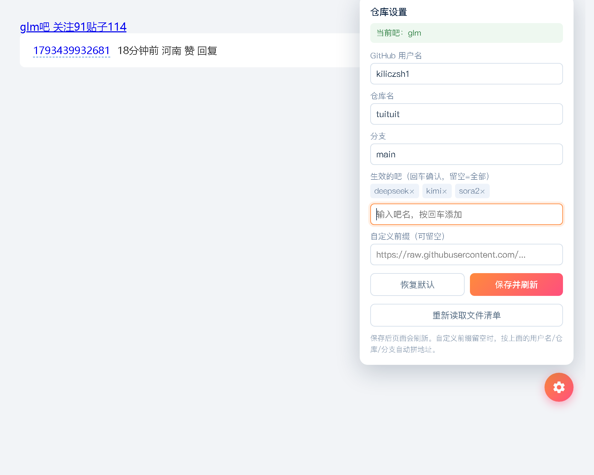

# hubuuid

把贴吧帖子里提到的文件名，自动变成指向你 GitHub 仓库的可点击链接。



帖子里有人发 `1793439932681` 或 `h8876hfrti.md`，装完就能点，点开就是仓库里那个文件。

## 安装

1. 装 [Tampermonkey](https://www.tampermonkey.net/) 或 Violentmonkey
2. 打开 [hubuuid.user.js](hubuuid.user.js) 点安装

## 配置

贴吧页面右下角点橙色齿轮，填三项：

| 字段 | 说明 |
| --- | --- |
| GitHub 用户名 | 你的账号名 |
| 仓库名 | 比如 `my-files` |
| 分支 | 一般是 `main` |

可选两项：

- **生效的吧**：输吧名按回车加一个，留空表示所有吧都生效
- **自定义前缀**：留空自动拼 `raw.githubusercontent.com/<用户名>/<仓库>/<分支>/`，走加速镜像才填

保存后页面刷新。配置存在你自己的浏览器里，不同步给别人。

## 文件名怎么起

脚本拿仓库**根目录**的文件名去页面上找，名字不合规就点不了。

**必须放仓库根目录。**

脚本请求的是 `api.github.com/repos/<用户名>/<仓库>/contents/`，不带任何路径参数，拿到的只有**根目录这一层**。子目录里的文件不在清单里，页面上出现也不会被认出来。

```
my-repo/
├── 1793439932681.jpg        帖子发 1793439932681     → 能点
├── h8876hfrti.md            帖子发 h8876hfrti       → 能点
├── 2024-report.pdf          帖子发 2024-report      → 能点
│
├── docs/
│   ├── guide.md             帖子发 guide            → 点不了
│   └── setup.md             帖子发 setup            → 点不了
│
└── images/
    ├── 1779779069090.png    帖子发 1779779069090    → 点不了
    └── 3a9f1c2b7d.md        帖子发 3a9f1c2b7d       → 点不了
```

想分类又不想失效，只能靠**文件名前缀**，别建文件夹：

```
my-repo/
├── img-1793439932681.jpg    帖子发 img-1793439932681  → 能点
├── doc-h8876hfrti.md        帖子发 doc-h8876hfrti    → 能点
```

代价是帖子里得把前缀一起打出来。

**字符**：名字被贴吧表情切断时需要拼接，拼接只认 `0-9 A-Z a-z . _ ~ -`。中文名能匹配，但被切开就拼不回来。空格容易被转成不换行空格，也别用。

**不带扩展名写有门槛**：长度 ≥ 8、含数字、且没有同名不同扩展名的文件，三条都满足才生效。

| 帖子里的写法 | 结果 |
| --- | --- |
| `1793439932681` | 能 |
| `h8876hfrti` | 能 |
| `notes` | 不能（太短又不含数字），得写 `notes.md` |
| `id1793439932681` | 不能，紧贴字母认不出 |

这几个名字不处理：`LICENSE` `README.md` `readme` `.gitignore` `index.html` `package.json`。

## 工作方式

进页面拉一次 GitHub 的 `contents` 接口取文件名清单，缓存一小时；扫描页面文本替换成链接；`MutationObserver` 跟进动态加载的内容。

`.md` 链接后面有个小按钮，可以在「渲染」和「原文」之间切——渲染走 `github.com`，排版好看但要拉整个页面；原文走 raw，快。

## 限制

- GitHub 接口未登录时每小时 60 次，超了会提示 429，点面板里「重新读取文件清单」重试
- 只支持贴吧，其它站点要改 `@match`
- 仓库加新文件后最多一小时才会被认出来
- 链接后面的「第N楼」和表情会被删掉，刷新页面恢复

## 许可

MIT
